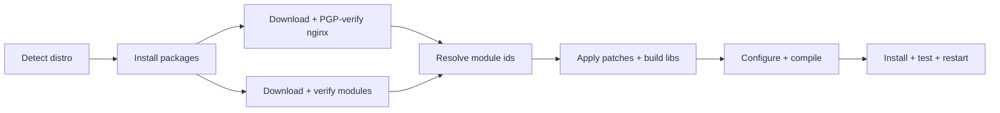

<div align="center">

# nginx-installer

Build nginx from source with verified modules, selectable profiles, and GeoIP support.

[](https://github.com/tmiland/nginx-installer/releases)
[](https://github.com/tmiland/nginx-installer/blob/main/LICENSE)
[](https://github.com/tmiland/nginx-installer)
[](https://github.com/tmiland/nginx-installer/actions/workflows/tests.yml)
[](https://github.com/tmiland/nginx-installer/actions/workflows/test-install.yml)

[Installation](#installation) · [How it works](#how-it-works) · [Compatibility](#compatibility) · [Troubleshooting](#troubleshooting) · [Usage](docs/usage.md) · [Contributing](CONTRIBUTING.md)

</div>

## Why this installer

- ✅ nginx source tarballs are PGP-verified against pinned nginx.org signing keys.
- ✅ Third-party sources are pinned and checksum-verified from [`tmiland/nginx-modules`](https://github.com/tmiland/nginx-modules).
- ✅ Module dependencies resolve automatically; `lua-nginx` pulls in `luajit2` and `ngx-devel-kit`.
- ✅ Minimal and full built-in profiles; third-party modules by id or curated bundle.
- ✅ GeoIP credentials stay in a mode-0600 env file instead of the process list.
- ✅ CI builds on Debian 12/13 and Ubuntu 22.04/24.04.

## Demo


Recorded on Debian 13 with nginx 1.31.9. The full install commands are in [Installation](#installation).

## Installation

Run the installer as root. The examples use `sudo`; omit it if you are already root.

### 1. Download

Latest tested release:

```bash
curl -fsSL https://github.com/tmiland/nginx-installer/releases/latest/download/nginx_installer.sh -o nginx_installer.sh
chmod +x nginx_installer.sh
```

The `main` branch is available for development, but is not the tested release:

```bash
curl -fsSL https://raw.githubusercontent.com/tmiland/nginx-installer/main/nginx_installer.sh -o nginx_installer.sh
chmod +x nginx_installer.sh
```

### 2. Choose a recipe

| Recipe | `--profile` | `--modules` | Native HTTP/3 |
|---|---|---|---|
| Full module mainline | `full` | `all` | yes |
| Minimal mainline | `minimal` | `all` | no |
| Nginx only | `minimal` | none | no |
| Stable default | `minimal` | none | no |

### Full module mainline install

Full built-in profile, the `all` third-party module set, GeoIP, and the bad bot blocker:

```bash
sudo ./nginx_installer.sh -m \
  --profile full \
  --modules "all" \
  --geoip-env-file "$HOME"/.credentials/geoip.env \
  --bad-bot \
  --dir /opt/nginx
```

`-m` selects the latest mainline nginx. Remove `--bad-bot` if you do not want the blocker.

> [!NOTE]
> `--modules "all"` includes `geoip2`, so the GeoIP credentials file is required.

### Minimal mainline install

The same `all` module set with the smaller built-in profile:

```bash
sudo ./nginx_installer.sh -m \
  --profile minimal \
  --modules "all" \
  --geoip-env-file "$HOME"/.credentials/geoip.env \
  --bad-bot \
  --dir /opt/nginx
```

The minimal profile builds TLS, HTTP/2, real IP, threads, file AIO, PCRE, and compatibility support only. It does not include native HTTP/3; `--profile full` adds that.

For nginx only, with no third-party modules:

```bash
sudo ./nginx_installer.sh -m --profile minimal
```

### Stable defaults

With no arguments, the installer builds the latest stable nginx with the minimal built-in profile and no third-party modules:

```bash
sudo ./nginx_installer.sh
```

### 3. Optional: install the script system-wide

```bash
sudo mkdir -p /opt/nginx-installer
sudo curl -fsSL https://github.com/tmiland/nginx-installer/releases/latest/download/nginx_installer.sh -o /opt/nginx-installer/nginx-installer.sh
sudo chmod +x /opt/nginx-installer/nginx-installer.sh
sudo ln -sf /opt/nginx-installer/nginx-installer.sh /usr/local/bin/nginx-installer
sudo nginx-installer
```

## How it works



The installer never installs a distribution nginx package. It verifies the nginx source and the module bundle, resolves module dependencies, applies the selected patches, compiles nginx, installs it, and tests the configuration before restarting the service.

[Full build flow, module bundle, and verification boundaries →](docs/how-it-works.md)

## Compatibility

| Platform | CI coverage |
|---|---|
| Debian 12 (bookworm) | build + uninstall |
| Debian 13 (trixie) | build + uninstall; module jobs |
| Ubuntu 22.04 / 24.04 | build + uninstall |
| Linux Mint 21.3 / LMDE 7 | detection |

Debian 9+ is the intended range; Debian 12/13 are the current CI baseline. Stable 1.30.7 is covered by CI; mainline 1.31.9 was manually verified with the full module set.

[Full compatibility matrix and verification details →](docs/compatibility.md)

## Troubleshooting

| Symptom | Fix |
|---|---|
| `pkg-config not found` | Upgrade to v2.0.1+ |
| `Cannot prepare build directory: /opt/nginx` | Upgrade to v2.0.1+, or pass `--dir "$(realpath -m /opt/nginx)"` |
| `ngx_http_lua_module 0.10.29 required` | Use `nginx-modules` v2026.11.6+ |
| `tlsdyn` patch fails | Use `nginx-modules` v2026.11.5+ |
| `geoip2 requires GeoIP credentials` | Create `~/.credentials/geoip.env` |

[Full troubleshooting guide and diagnostics →](docs/troubleshooting.md)

## Usage

```bash
sudo ./nginx_installer.sh --help
sudo ./nginx_installer.sh --detect
sudo ./nginx_installer.sh --modules "web,lua"
```

The full option list, profile table, module bundle reference, and GeoIP details live in [docs/usage.md](docs/usage.md).

## Requirements

- Debian 9 or later, and Debian-family distributions including Ubuntu.
- Root access.
- Network access to nginx.org, GitHub, and the module sources.
- Enough disk space and RAM to compile nginx and the selected modules.

[Requirements and tested platforms →](docs/compatibility.md#requirements)

## Verifying the build

```bash
nginx -V
```

The configure arguments show the selected profile and every `--add-module`. That line is the authoritative record of what was compiled.

## Contributing

See [CONTRIBUTING.md](CONTRIBUTING.md) for the test commands, CI layout, module-change workflow, and release steps.

## Changelog

See [GitHub Releases](https://github.com/tmiland/nginx-installer/releases) for version history and release notes.

## Credits

- Code is mixed and customized from [nginx-autoinstall](https://github.com/angristan/nginx-autoinstall).

## Donations

<a href="https://coindrop.to/tmiland" target="_blank"></img></a>

## Disclaimer

***Use at own risk.***

## License

[](https://github.com/tmiland/nginx-installer/blob/main/LICENSE)

[MIT License](https://github.com/tmiland/nginx-installer/blob/main/LICENSE)
