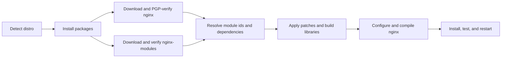

# How it works

The installer builds nginx from source and never installs a distribution nginx package. The short version:

## Phases

1. **Preflight** - require root, detect the distribution, validate the build directory, and install build dependencies.
2. **Source** - download the selected nginx tarball and verify its PGP signature against pinned nginx.org keys.
3. **Modules** - download the `nginx-modules` release, verify `SHA256SUMS`, read `modules.conf`, resolve `requires`, and select the requested ids or bundles.
4. **Preparation** - apply patch modules in a fixed order, build helper libraries, install Lua libraries, and download GeoIP databases when selected.
5. **Build** - configure nginx with the selected profile and module flags, then compile it.
6. **Install** - run `make install`, write the service and configuration files, test the configuration, and restart nginx.

## The module bundle

`nginx-modules` is the only third-party source. Its release contains the module trees, `modules.conf`, `bundles.conf`, and the patch files. The installer treats those files as data, not shell:

- `modules.conf` maps an id to its directory, source kind, build arguments, dependencies, and environment label.
- `bundles.conf` maps a bundle name to a comma-separated id list.
- `requires` is resolved recursively, and cycles are rejected.
- `MODULES_REV` pins the release; `latest` follows the newest tested release.

## Verification boundaries

The installer verifies the nginx source, the module bundle checksum, `src/slib.sh`, and individual module sources. It does not claim to audit the upstream source code itself.

## Related

- [Usage reference](usage.md)
- [Compatibility](compatibility.md)
- [Troubleshooting](troubleshooting.md)
